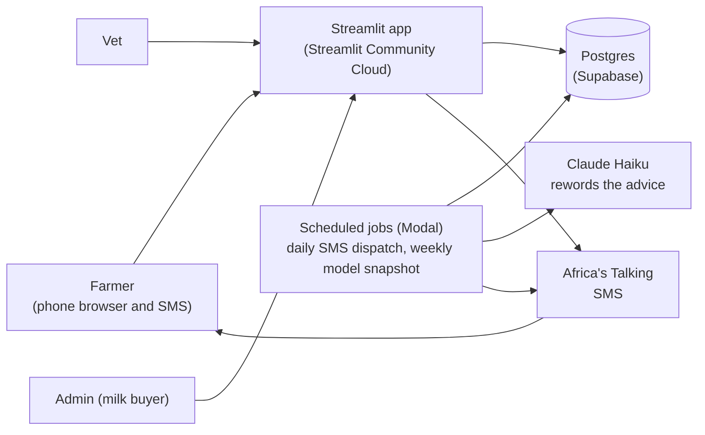

# Maziwa Plus (Milk Tracker)

*Know what your feed is worth.* A web app and SMS service for smallholder dairy farmers in Kenya, their route vets, and the milk buyer's admin. (Earlier working name: Milk Tracker. Entered in the FNB App of the Year hackathon as Maziwa Plus.)

## The problem

Kenya's dairy sector rests on smallholders: more than one million of them produce about 80% of the milk ([Tegemeo Institute and Kenya Dairy Board cost study, 2014 data](https://tegemeo.egerton.ac.ke/images/_tegemeo_institute/downloads/pressreleases/dairy%20study%20press%20release%2019th%20july%202016.pdf)). Feed is the biggest cost, 43% to 58% of the total cost of producing milk, while farmgate prices of KSh 37 to 48 a litre "are not sufficient to cover the high production costs in some cases" ([Kenya Dairy Board report, 2024](https://dairybusinessmea.com/?p=2115904)). Yet feed is bought by feel: nobody tells a farmer which feed actually moves their cows' milk. AI semen, vet visits, vaccination and outbreak news run on phone calls, and the buyer deducts costs from the monthly milk payment, so the farmer sees the effect on profit only at month end.

## What it does

Four roles, each with its own menu and its own data:

| Role | What they do |
|---|---|
| **Farmer** | Logs milk (3 milkings a day), feed and water in litres; uses a feed calculator (truck load to price per mtungi or kg); sees feed margin and AI semen cost; keeps herd records (cows, heifers, calves, breeding, dry period, deworming); asks the route vet, or a vet of their own choosing, for AI, a sick-cow visit or anything else; books vaccination days; reads outbreak alerts; receives SMS advice; on **Feed stock**, records loads as they arrive and when they finish, in their own units (a truck, a bag), and sees what is left and when each feed runs out; on **Money**, sees the month's milk income, the buyer's deductions and expected payout, what is owed to whom, and records costs from any supplier (agrovet, the buyer's store). |
| **Vet** | Keeps a priced semen list; sees a "my day" sheet with the visits, the farms and what to carry; schedules and completes visits (an AI visit also records the service on the cow) and bills them: fee, drugs and semen, paid now, on credit or (route vets only) deducted from the milk payment; on **Money**, sees who owes them and records payments; posts vaccination days and alerts for their own routes. |
| **Agrovet** | Keeps a priced product list; receives farmers' pre-orders and confirms them at that day's prices (or declines, saying why); sees what's ready each day, deliveries grouped by route; hands over and bills the order (paid now or on credit), which also restocks the farm's Feed stock; on **Money**, sees who owes it; sees its own customers, best first. |
| **Admin** (the milk buyer) | Creates routes and allocates vets; approves sign-ups; posts outbreak alerts and vaccination days for any route; texts alerts; sees each vet's attended, to-do and late visits for the day. | A route admin is an admin limited to the routes the head admin gives them: they see those routes' attendance, send alerts and vaccination days for them, and cannot reach set-up, sign-ups or deletes. |

#### Neutral between providers

A farm on a buyer's route keeps the route vet as the default, and can add independent vets and send any request to one of them. Each cost records who supplied it and how it is settled, so the farmer sees the buyer's month-end deductions before payday and their full costs in one place. The buyer's admin sees only route-vet requests, never what a farm spends elsewhere. The app records money; it never moves or holds it.

## How the feed advice works

The advice is deliberately cautious. A per-farm model estimates what each feed does to milk, and a message is sent only when the evidence is clear.

- It needs at least 14 full days (all milkings, cows in milk known, feed logged). Until then the farmer gets a plain note saying what data is missing, never a generic tip.
- Each feed is tested against that farm's own data, with a correction for testing several feeds at once, and a feed that always moves together with another is refused rather than guessed at.
- A suggestion changes one feed by at most 10%, and only when even the pessimistic end of the estimate pays after the feed's cost.
- Claude Haiku may reword the SMS, but every number and feed name comes from the model's facts. The rewording is rejected, and a plain template sent instead, if it changes a figure, drops the feed, flips the direction, promises a result, adds a link, or won't fit in two SMS segments.

## Architecture



- **App:** Streamlit multipage app. Every page calls `require_login` first, and data is filtered by role in `src/accounts.py`.
- **Database:** Postgres on Supabase, raw SQL through psycopg2 (no ORM). `sql/schema.sql` is idempotent. Composite foreign keys make the database itself refuse another farm's cow or semen.
- **Model:** `src/models.py` (per-feed regression with lag), `src/suggestions.py` (the decision), `src/messages.py` (wording and the checks on any rewording).
- **SMS:** `src/sms.py` (Africa's Talking client, every attempt logged in `sms_log`), `src/dispatch.py` (at most one SMS per farmer per day; advice every 14 days; a data nudge every 7).
- **Jobs:** `modal_jobs/` runs the daily dispatch (05:00 UTC) and the weekly model snapshot (Monday 04:00 UTC) on Modal.

## Try it

A hosted demo with logins for each role is on the submission slides. The demo uses **simulated** data and its own database, never a real farm's.

To run your own copy:

```bash
git clone https://github.com/wanjira234/milk-tracker
cd milk-tracker
python -m venv .venv && source .venv/bin/activate
pip install -r requirements.txt
cp .env.example .env                     # then fill in your values (never commit .env)
psql "$DATABASE_URL" -f sql/schema.sql   # on Supabase: SQL editor, then "Run and enable RLS"
streamlit run app.py
python -m src.demo_seed                  # demo admin, vet, agrovet, a farmer with 40 days of simulated data, and a second farm one day short of advice
python -m src.demo_seed --password <pw>  # give every demo login the same password (also unlocks them)
python -m src.demo_seed --reset-fresh    # put that second farm back to its 15 simulated days (judges add to it)
```

Set `DEMO_PASSWORD` in your shell first if you want all the demo logins to share one password you choose. The second farm (`newfarm@demo.milk`) has 15 simulated days and yesterday left empty: log yesterday's milk and feed (pick yesterday's date) and its 14th usable day unlocks the model. Running the seed again only adds what is missing, so it is safe on an existing demo database.

The seed asks you to type `demo` and shows the database host before it writes anything. Use a **separate** demo database. In the SMS tab, codes only reach real phones once Africa's Talking is on a live account; until then use the email and password tab (the demo logins) or the Africa's Talking sandbox simulator.

### Tests

```bash
pytest                                      # logic tests
TEST_DATABASE_URL=postgresql://... pytest   # also the database and page tests (they truncate tables: use a throwaway database)
```

## What was built when

The app existed before the hackathon and the git history shows what is new. In Nairobi time:

- **Before the 23 Oct 12:40 start:** milk and feed logging, the per-farm model and SMS advice, hosting, the feed calculator and profit view, per-cow records, calves and heifers, accounts with farmer/vet/admin roles, routes, sign-up with admin approval and demo accounts.
- **From Fri 23 Oct 15:02:** vet service requests with a priced semen list, the vet's day sheet, the admin's attendance view, AI semen cost in the farm's profit and role-based menus (part of this code was drafted on Thursday night and committed on Friday).
- **Sat 24 Oct onwards:** outbreak alerts and notices with confirmed, send-once SMS; the SMS outbox; vaccination days with booking; a cleaner sign-in screen and a menu for each role; a faster, all-or-nothing demo seed.
- **On branches, not yet on the judged demo (from 3 Nov):** vet choice and the money ledger, purchases and feed stock, agrovet pre-orders, then organisations, shop list, visible M-Pesa/cash/milk-deduction payments, feed presets, and agrovet sales insights and offers.

## AI use

Built with Claude Code assistance. Claude Haiku rewords SMS advice under the checks above. The simulated demo data is labelled as simulated.

## Security and limits

See [SECURITY.md](SECURITY.md) for what is protected, how, and what is not yet done. Honest limits: SMS login codes need a live Africa's Talking account to reach real phones; the Swahili SMS wording is a draft awaiting a native speaker's review; there is no password-reset flow yet; and nothing here is a substitute for a data-protection review before real farmers' data is held at scale.

## Licence

Proprietary, all rights reserved: see [LICENSE](LICENSE). The code is public so that the hackathon judges can read it; copying, forking for reuse, redistribution and commercial use need written permission. The demo uses simulated data only.

## More

[CONTEXT.md](CONTEXT.md) has the full project layout, decisions and working conventions.
